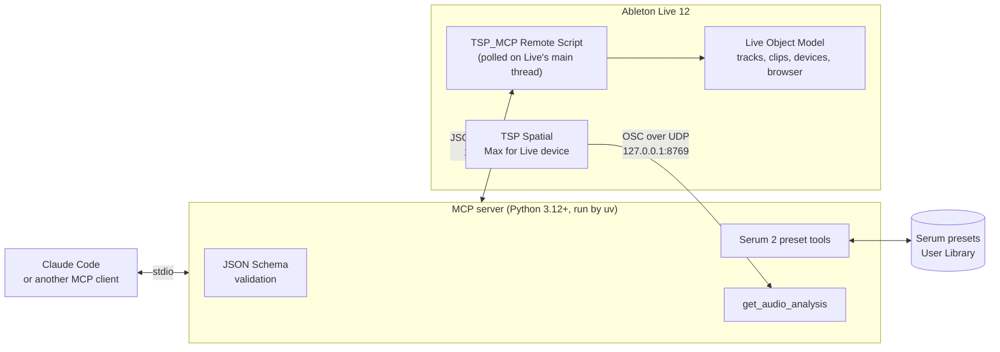
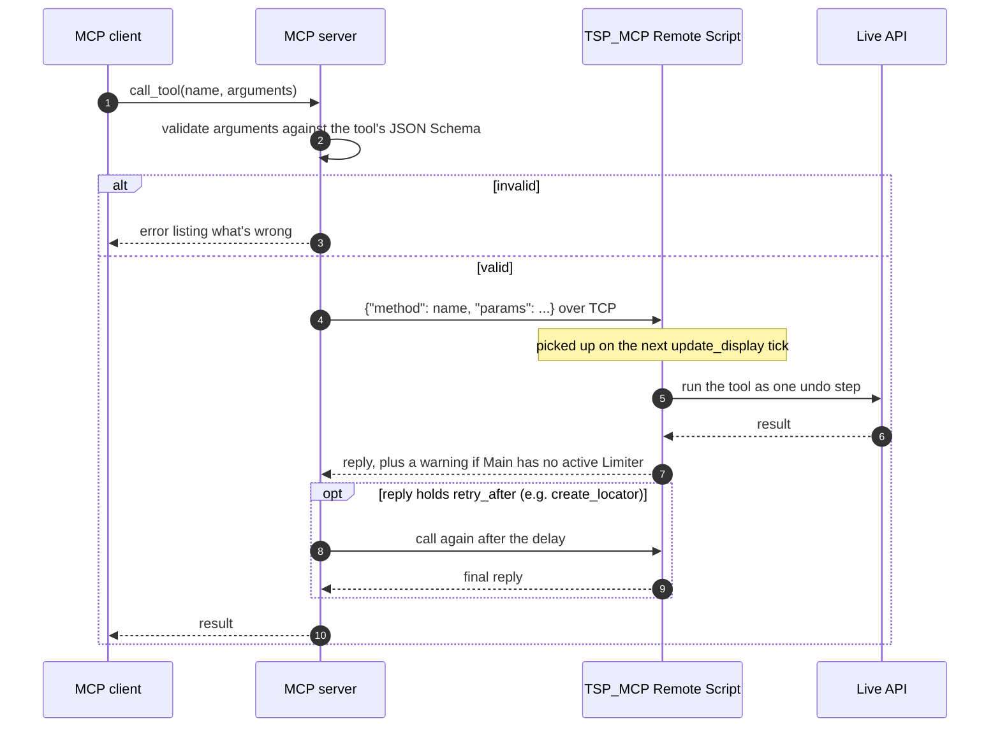
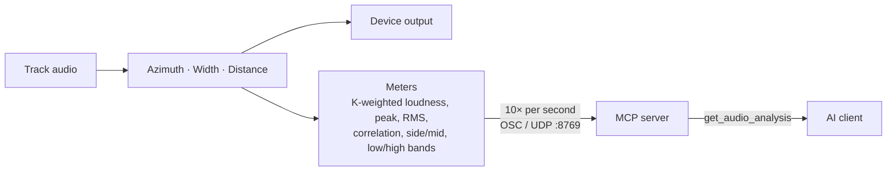
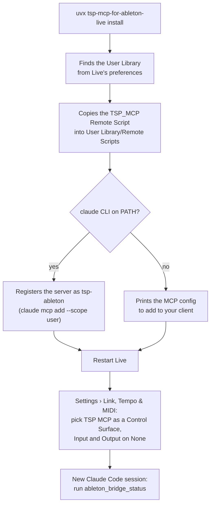

# TSP for Ableton Live

Tools that let Claude and other [MCP](https://modelcontextprotocol.io) clients work inside Ableton Live 12: build tracks, write clips and drum patterns, load instruments and presets, arrange a song, and measure what it sounds like.

| Folder | What it is |
|---|---|
| [`mcp/`](mcp) | **TSP MCP for Ableton Live**: an MCP server plus a Live Remote Script, with 57 tools for sessions, tracks, clips, notes, drums, devices, the browser, the arrangement, and Pigments and Serum 2 presets. |
| [`max-for-live/`](max-for-live) | **TSP Spatial**: a Max for Live audio effect that places a sound in the stereo field and reports loudness, levels, stereo width and frequency balance back to the MCP server, so the AI can check its work without hearing it. |

This project is independent and isn't affiliated with or endorsed by Ableton, Cycling '74, Arturia or Xfer Records. All product names are trademarks of their owners.

## How it fits together



Live's embedded Python is old and gives threads very little time, so the work is split. The MCP server runs outside Live on a modern Python with the official MCP SDK. The Remote Script inside Live stays small, has no threads, and answers requests from Live's display tick about ten times a second.

### A tool call



### Audio measurements

Nothing in Live's API can hear audio. TSP Spatial measures the audio on its track and sends numbers instead:



## Setup

### Requirements

- Ableton Live 12 (tested with 12.4.16 Suite on Windows 11). TSP Spatial needs Live Suite or Max for Live.
- [uv](https://docs.astral.sh/uv/getting-started/installation/)
- An MCP client. The installer registers the server with [Claude Code](https://docs.claude.com/en/docs/claude-code) automatically; for other clients it prints the config to add.
- Python 3 to build TSP Spatial from source (standard library only).

### Install the MCP server and Remote Script



1. Install:

   ```
   uvx tsp-mcp-for-ableton-live install
   ```

   `--user-library <folder>` skips the User Library detection and `--no-register` skips registering with Claude Code.

2. Restart Live. Under **Settings > Link, Tempo & MIDI**, pick **TSP MCP** in an empty Control Surface slot and leave Input and Output on None.

3. Start a new Claude Code session and ask it to run `ableton_bridge_status`.

To update, run `uvx tsp-mcp-for-ableton-live@latest install` and restart Live. To remove it, run `uvx tsp-mcp-for-ableton-live uninstall`.

### Install TSP Spatial (optional)

```
cd max-for-live
python build.py --install
```

That builds `devices/TSP Spatial.amxd` and copies it to `User Library/TSP MCP/Devices`. Drop it on any track you want measured, then ask the AI to call `get_audio_analysis`.

### Working from a checkout

```
git clone https://github.com/TheSeasonedProgrammer/tsp-ableton.git
cd tsp-ableton/mcp
uv run --directory server tsp-mcp-for-ableton-live install --dev
```

`--dev` makes Live load the tools from your checkout, so tool edits only need `ableton_reload_tools` instead of a Live restart. Changes to `TSP_MCP/__init__.py` still need a reinstall and a restart.

### Ports and environment variables

| Variable | Default | Used for |
|---|---|---|
| `ABLETON_BRIDGE_PORT` | `8768` | TCP between the MCP server and the Remote Script |
| `ABLETON_ANALYSIS_PORT` | `8769` | UDP measurements from TSP Spatial (the device has 8769 built in) |
| `SERUM2_PRESETS` | from Serum's preferences | Folder holding `.SerumPreset` files |

Everything listens on 127.0.0.1 only.

## Hearing safety

Generated parts and new sounds can be much louder than expected. TSP MCP warns, in tool replies and in Live's status bar, whenever the Main track has no active Ableton Limiter. A Limiter can't make loud music quiet or control your monitor level, so start with your volume low.

## Tests

```
# MCP server and Remote Script, against a fake Live, on Live's Python version
cd mcp
uv run --no-project --python 3.11 python -m unittest discover -s tests

# TSP Spatial build
cd max-for-live
python -m unittest discover -s tests
```

`mcp/tests/live_check.py` runs the tools against a real running Live; see [`mcp/README.md`](mcp/README.md#tests).

## Repository layout

```
.
├── mcp/
│   ├── server/                         Python package published as tsp-mcp-for-ableton-live
│   │   └── src/tsp_mcp_for_ableton_live/
│   │       ├── server.py               MCP server (stdio), bridge client, analysis listener
│   │       ├── install.py, cli.py      install / uninstall commands
│   │       ├── serum.py, analysis.py   Serum 2 presets, TSP Spatial measurements
│   │       └── remote_script/TSP_MCP/  the Remote Script that runs inside Live
│   │           └── ableton_tools/      tool handlers, one module per area
│   └── tests/                          fake Live, bridge tests, live check
└── max-for-live/
    ├── build.py                        generates the .amxd from source
    ├── src/tsp_spatial.genexpr         gen~ audio code
    ├── devices/TSP Spatial.amxd        built device
    └── tests/
```

The detailed docs, including every tool, conventions, and the quirks of Live's API, are in [`mcp/README.md`](mcp/README.md) and [`max-for-live/README.md`](max-for-live/README.md).

## License

Licensed under the [Apache License, Version 2.0](LICENSE). See [NOTICE](NOTICE).
